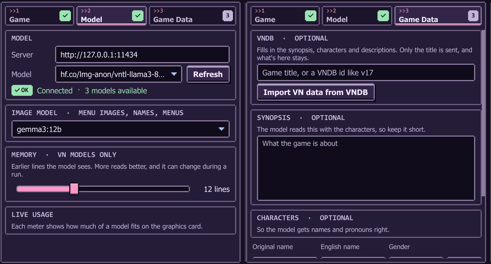
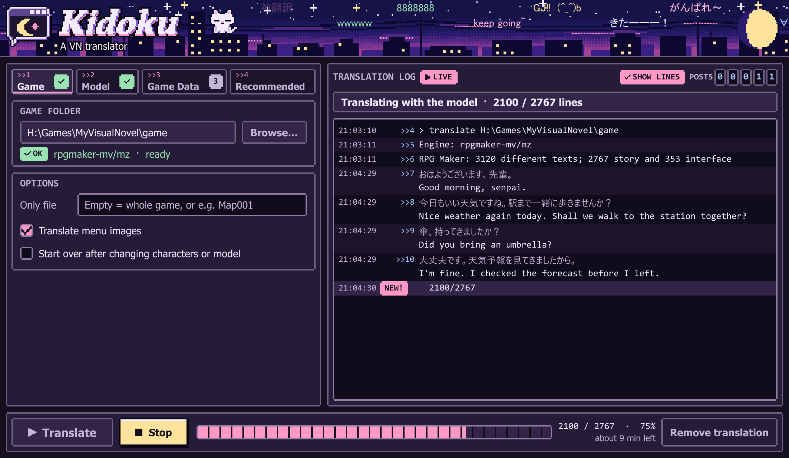

<p align="center">
  
</p>

# Kidoku guidebook

> **`! STICKY`** &nbsp; **Anonymous Cat** &nbsp; (=^ω^=)
>
> **New here? Read `>>1` and `>>2`, then go translate something.**
>
> The rest is for when you want to fix something: names, pronouns, text that doesn't fit, menus still in Japanese.

**Contents**

- [`>>1` Set it up](#1-set-it-up)
- [`>>2` Your first translation](#2-your-first-translation)
- [`>>3` The Game tab](#3-the-game-tab)
- [`>>4` The Model and Recommended tabs](#4-the-model-and-recommended-tabs)
- [`>>5` The Game Data tab](#5-the-game-data-tab)
- [`>>6` The log](#6-the-log)
- [`>>7` Making text fit the box](#7-making-text-fit-the-box)
- [`>>8` Menu images](#8-menu-images)
- [`>>9` Stopping, starting over and undoing](#9-stopping-starting-over-and-undoing)
- [`>>10` What each engine can do](#10-what-each-engine-can-do)
- [`>>11` Command line](#11-command-line)
- [`>>12` Your files](#12-your-files)
- [`>>13` When something goes wrong](#13-when-something-goes-wrong)

---

## `>>1` Set it up

You'll need:

- Windows, the only system it's built and tested on
- [Ollama](https://ollama.com), which runs the models on your PC
- A GPU with about 6 GB of memory free, and about 6 GB of disk for the VN model

Get **Kidoku-Setup.exe** from the [latest release](https://github.com/vVKamiVv/Kidoku/releases/latest) and run it. It installs for your Windows user, with no administrator rights, and adds Kidoku to the Start menu. Windows may warn about an unknown publisher, because the app isn't signed: choose **More info**, then **Run anyway**. To remove it, use **Installed apps** in Windows Settings. Games you translated keep their translation, so use **Remove translation** first if you want them back in Japanese.

When a new version is out, Kidoku says so at the top of its window. Press **Update** to download it, check it against its published checksum, and reopen in the new version, or **Later** to be reminded next time. Your settings, models and translations stay. An update can't start during a run.

The check only asks GitHub what the newest version is, and sends nothing of yours. To turn it off, clear **Check for updates when Kidoku starts** at the bottom of the **Recommended** tab. **Check now** there asks whenever you like.

To build it yourself instead, get [Rust](https://rustup.rs), the current stable version:

```bash
git clone https://github.com/vVKamiVv/Kidoku.git
cd Kidoku/app
cargo build --release
```

Then open **Kidoku.bat** in place of the installed app.

Start Ollama and open **Kidoku**. In the app, open the **Recommended** tab and press **Get** on the biggest text model your graphics card holds. **VNTL Llama 8B** is the one for 8 GB, about 6 GB to download.

Then get two more from the same tab. They're optional, but they do jobs the translation model can't:

- **Text reader**, 33 MB. It reads Japanese in menus and screenshots on the CPU, so it needs no GPU memory.
- **An image model**, like **Gemma 3 12B**. It works out genders, translates menu labels, retries lines that failed and measures English screenshots.

Whatever you download is put to use right away. To switch later, press **Use** on the Recommended tab or pick it on the **Model** tab.

## `>>2` Your first translation

1. On the **Game** tab, press **Browse…** and pick the game's folder.
2. Check that the tab shows the engine with an **OK**. If you picked a folder around the game, the app finds the game inside it by itself.
3. On the **Model** tab, check the server says **Connected** and the model is the VN model.
4. Press **Translate**.
5. When the status says **Done**, start the game and play.

Each line shows in the log as it's translated. At 90 to 200 lines a minute, depending on the game and what else is using your GPU, a 5,000-line game takes about 25 minutes to an hour.

On most engines, a long line the same speaker says again is translated once and reused, so it reads the same both times.

> **The game only changes at the end of a run.** You can stop and carry on as often as you like, but the English goes in when the run finishes. See [`>>9`](#9-stopping-starting-over-and-undoing) to try it partway.

Your original files are backed up before anything changes, so **Remove translation** can always put them back.

## `>>3` The Game tab

<p align="center">
  
</p>

The window only shows options your game's engine can use, so yours may have fewer than this list.

| Option | What it does | Shown for |
|---|---|---|
| **Official translation** | A copy of the game with an official translation. Its lines are copied, and the model does the rest | Ren'Py |
| **Scene label** or **Only file** | Translates just one scene or data file, for a quick sample | Ren'Py, RPG Maker MV/MZ |
| **Translate menu images** | Repaints buttons and menus in English. See [`>>8`](#8-menu-images) | Ren'Py, Liar-soft, RPG Maker MV/MZ, Artemis |
| **Text over artwork** | Also paints English over text inside pictures. Off by default. See [`>>8`](#8-menu-images) | Ren'Py |
| **Retranslate existing text** | Translates text the game already has in your language | Unity |
| **Start over after changing characters or model** | Sets the saved translations aside and redoes the game | All |
| **Read script again after a game update** | Reads the script again instead of using the saved copy | Ren'Py |
| **Fit text to the box…** | Measures the message box from a screenshot. See [`>>7`](#7-making-text-fit-the-box) | Engines that break their own lines |

## `>>4` The Model and Recommended tabs

**Model** is the server and the model that translates the story. The server address is Ollama's unless you changed it.

**Image model** does the jobs that need a model that follows instructions:

| Job | Without an image model |
|---|---|
| Working out character genders | Genders stay as you set them |
| Translating and repainting menu images | Images stay in Japanese |
| Measuring the message box | **Fit text to the box** only measures Japanese, with the text reader |
| Translating names and menu terms on RPG Maker | The VN model does it, less reliably |
| Retrying RPG Maker lines that failed the checks | They stay in Japanese |

**Memory** is how many earlier lines the model sees, from 6 to 24. The model starts from this many and keeps up to twice as many before forgetting the oldest in one go, which keeps it fast. You can move it during a run, and it applies to new lines. More reads better and runs a little slower:

| Memory | Lines per minute |
|---|---|
| 6 lines | About 98 |
| **12 lines (default)** | **About 91** |
| 24 lines | About 82 |

<sub>Measured side by side on an RTX 3060 Ti 8 GB with other programs using the card. A free card went about twice as fast.</sub>

**Live usage** updates every 2 seconds while the tab is open:

| Row | What it tells you |
|---|---|
| This app | The app's own RAM and CPU |
| Model server | Ollama's RAM and CPU |
| Each loaded model | How much is in VRAM and how much in RAM |
| Graphics card | VRAM used by every program on the card, and how busy it is |

Meters are pink when normal, yellow when high and red when nearly full. A model's meter works differently: **green** means it fits on the card, and **yellow** means part of it spilled into RAM, which is much slower. If you see yellow during a run, close other programs that use the GPU.

The graphics card row needs an NVIDIA card. Model rows need Ollama.

### The Recommended tab

This tab lists models that suit the app, split into **Text models** and **Image models**, smallest first. Each one shows its download size and the graphics card memory it wants. Press **Get** to download one: the bar at the bottom follows the download, and the model is put to use when it's done. A model you already have shows **Use**, or **IN USE** if it's the one picked.

| Text model | Download | GPU | |
|---|---|---|---|
| VNTL Gemma 2B | 2.8 GB | 4 GB | For small GPUs |
| **VNTL Llama 8B** | **5.7 GB** | **8 GB** | **The default** |
| VNTL Llama 8B, finer | 8.5 GB | 12 GB | The same model, less compressed |
| VNTL Gemma 27B | 13.4 GB | 16 GB | A much larger model |
| VNTL Gemma 27B, finer | 19.4 GB | 24 GB | The strongest here |

| Image model | Download | GPU | |
|---|---|---|---|
| **Text reader (meikiocr)** | **33 MB** | **CPU** | **Reads Japanese in images. Get this first** |
| Font pack (20 free fonts) | 110 MB | CPU | More looks for repainted images, brush lettering too |
| Gemma 3 12B | 8.2 GB | 12 GB | The one tested most with this app, and slower on 8 GB |
| Gemma 4 12B | 8.0 GB | 12 GB | Not tested with this app yet |
| Gemma 4 26B | 18.7 GB | 24 GB | Not tested with this app yet |
| Qwen 3.5 27B | 17.5 GB | 24 GB | Not tested with this app yet |

All the text models are fine-tuned on visual novels, because general models can refuse adult text. The image models are general ones, so they can refuse it too. That can cost you a gender guess or a retry, but nothing else.

The text reader isn't an Ollama model. It's kept in `%APPDATA%\VN Translator\ocr` and used by itself once it's there, so it shows **READY** and has nothing to pick.

## `>>5` The Game Data tab

This tab holds what the app knows about the game. All of it is optional and editable, and the character list is the best way to improve a translation.

**Import VN data from VNDB** is the quick way to fill it in. The box starts with the folder's name; change it to the game's title or its VNDB id, like `v17`, if that finds the wrong game. It only sends that title to [vndb.org](https://vndb.org), and it only fills blanks, so your spellings, genders and edits stay, and so do names from an official translation. Import before your first run: genders from VNDB save the image model the guesswork, and you get a character list straight away.

VNDB can spell names differently from the game, so point the app at an official translation if you have one, or fix them in the list. Where VNDB says a character turns out differently, the list has them as they appear, so it spoils nothing.

**Synopsis** goes to the model with the character notes. It's cut to about 1,000 letters on import, and it takes room in every prompt, so keep it short.

**Descriptions** are for you. Pick a character to read or edit theirs. They don't go to the model.

**Characters** tells the model who's who:

| Column | What to put there |
|---|---|
| **Original name** | The name as the game writes it, like ハナ |
| **English name** | How to spell it. This goes into the game as written |
| **Gender** | Female, Male, Non-binary or Not set. It decides the pronouns |

The app adds the names it finds during a run. Press **Add character** for anyone it missed.

**Genders work themselves out.** With an image model picked, each run reads a sample of the lines around each character with a blank gender, and fills it in. The log says what it decided.

On Ren'Py games that keep each character's art in a folder named after their speaker code, like `images/char/ch_07_ab/`, the model also looks at the character's sprite. The sprite wins if the two disagree, and the log flags that, so those are the rows to check. If the sprite could be either, the lines decide.

**Other names of one character are linked too.** On Ren'Py, the script often shows that two names are one person: a speaker code like `kd_q` belongs with `kd`, and a name variable like `pc2` belongs with `pc`. Those names share one answer, so a disguise follows the character's sprite and not its label, and the model is told they're aliases. Your rows stay as they are, and the log lists each link. A gender you set yourself on a row always stays.

The script can be wrong about this, so the **Game Data** tab lists these links under **Linked names**. Press **Unlink** on any that are really two people, or **Link** to put one back. The next **Translate** uses your choice.

- Anything you set by hand is left alone.
- Unclear answers stay blank and get asked again next run.
- It needs a character with at least 5 lines or a sprite, and an engine that names its speakers.
- It only runs while story is left to translate.
- Lines already translated keep their pronouns. To apply new genders to them, use **Start over**.

Glance over the answers before a long run: a wrong gender affects every line for that character.

## `>>6` The log

<p align="center">
  
</p>

Each translated line lands in the log as a post, and the moon fills with progress. Turn **SHOW LINES** off to hide the text, which is handy if someone's looking at your screen. The progress bar keeps going.

Warnings also appear here, such as how many lines stayed in Japanese.

## `>>7` Making text fit the box

Most engines don't say how wide their message box is, so the app starts with a sensible size. If the text overflows or breaks early, measure the real box:

1. Play to a **long** message that reaches the right edge of the box, and take a screenshot. Before translating is ideal: with the text reader, a Japanese line in a PNG, JPEG or WebP is measured on the CPU in a few seconds. Any other screenshot needs an image model.
2. On the **Game** tab, press **Fit text to the box…** and pick the screenshot.
3. Press **Translate**. Nothing is translated again: the app just rewrites the game to fit.

The width is saved for that game in `vntl_work/box.txt`:

```text
letters=39
rows=3
```

- The screenshot must show a line that truly reaches the edge. A short line gives a width that's too narrow.
- A saved width only ever comes down. To raise it, edit the file.
- Only width is measured, because the model can't count rows reliably. Set `rows=` by hand if you need to. It only matters on Artemis and NScripter, which start a new page by themselves.
- YU-RIS and TyranoScript wrap text themselves, so they don't have this button.

## `>>8` Menu images

With an image model picked and **Translate menu images** on, the app finds the text in interface images, translates each screen together, and paints the English in. The text reader reads the labels, and the image model only reads what the reader can't, like a label running down the image. Without the text reader, the image model reads them all, which takes much longer.

The English is drawn in the font on your PC closest to the game's own lettering. The app finds it by redrawing the Japanese in each font and comparing the shapes, once per game, and saves the choice. The **Font pack** on the Recommended tab adds 20 free Japanese fonts to choose from, and a game matches again once after you get it.

Only text on a plain or transparent background is repainted. That protects your game's art, so these stay in Japanese:

- Text drawn over artwork, like a name on a character portrait
- Anything joined to a picture, so the app can't tell where the text ends

On Ren'Py the app looks through every PNG, WebP and JPEG in the game, not just the `gui` folder. A tall picture only counts if it has a plain backdrop, so characters are left alone, and a label on a picture has to read the same at two sizes before it's touched.

On Artemis, names drawn as pictures are read whole and spelled as your character list has them, so a name with no English stays Japanese.

### Text over artwork

Ren'Py games can go further with **Text over artwork**, which needs the text reader and an image model. The reader looks through each picture for Japanese rows, then the app covers each one with a patch built from the pixels around it and writes the English on top in white with a dark edge.

This is off by default for good reasons:

- It can take minutes: about 90 seconds for 400 pictures on a test game
- The patch shows, above all over faces or fine detail
- The reader can take a shape for text, and then a piece of the picture is painted over
- It reads PNG, WebP and JPEG, so pictures in other formats stay as they are

Your game's own files aren't changed, and **Remove translation** takes the pictures out. What it found is saved in `vntl_work/art_rows.json`, so a stopped run carries on.

To correct a label, edit `vntl_work/image_labels.txt` and run **Translate** again. Each line is the reading, then the English:

```text
読み取り = The English label
```

Some labels come out short or vague, because a menu gives the model little to go on. A label like `Volume` is worth checking against what the setting really does.

## `>>9` Stopping, starting over and undoing

| You want to… | Do this |
|---|---|
| Take a break | Press **Stop**, then **Translate** later. It carries on where it stopped |
| Try it partway | Press **Stop**, then run `vntl write <game>`. See [`>>11`](#11-command-line) |
| Apply a new model, or changed characters, to everything | Tick **Start over after changing characters or model**, then **Translate** |
| Go back to Japanese | Press **Remove translation** |
| Translate again after removing | Press **Translate**. Your saved lines are kept, so it's quick |
| Update the game | Press **Remove translation**, update, then **Translate**. Saved lines are used where they still match. On Liar-soft, use **Start over** too |

**Start over** doesn't delete anything. The old translations are set aside as `cache_english.before-1.json`.

If a game update changed a file, **Remove translation** keeps the new file and saves the older original as `*.vntl-orig.old-N`.

## `>>10` What each engine can do

Pick a folder and the Game tab names the engine. **Speakers** means the model is told who's talking, which also lets genders work themselves out. **Fit** means it has the **Fit text to the box** button.

| Engine | Speakers | Menu images | Fit | Keep in mind |
|---|---|---|---|---|
| Ren'Py | Yes | Labels on plain backgrounds, and text over artwork if you turn it on | | The game starts briefly so its script can be read |
| Unity | | | | Only games using Unity's Localization package |
| Liar-soft | Yes | Yes | | Speakers come from the game's name plates, so they need the text reader or an image model. The plates are repainted in English too, keeping their brackets. The engine patch needs a matching build |
| RPG Maker MV/MZ | Yes | Short images | Yes | Unlisted plugin settings stay Japanese |
| RPG Maker XP/VX/Ace | | | Yes | Script text is only changed where it's plainly shown on screen |
| RPG Maker 2000/2003 | | | Yes | Long messages go on to a new page |
| Malie | Yes | | Yes | Needs a Camellia key in the game's program |
| SiglusEngine | Yes | | Yes | The key is worked out from the game's scenes. The right-click menu and dialogs change too |
| QLIE | Yes | | Yes | FilePackVer3.1 packs only |
| Wolf RPG Editor | | | Yes | Old archives only |
| RealLive | Yes | | Yes | Compiler 10002 scripts only |
| CatSystem2 | Yes | | Yes | The passphrase must be in the game's program |
| Majiro | Yes | | Yes | ArcV3 archives only |
| YU-RIS | Yes | | | The engine's own wrap may cut words |
| BGI/Ethornell | Yes | | Yes | A few strings outside messages stay Japanese |
| AdvHD | Yes | | Yes | Shift-JIS scripts only |
| KiriKiri | Rarely | | Yes | Plain `.ks` scripts only, not encrypted archives or `.scn` |
| Artemis | Yes | Plain labels and drawn names | Yes | Version 6 and 8 archives; backlog names stay Japanese. On version 8 the game's archive stays as it is, and the English goes in one of its own |
| Softpal | Yes | | Yes | `Sv20` scripts only |
| FVP | Yes | | Yes | Strings the script only compares stay Japanese |
| TyranoScript | Yes | | | The engine's prompts change; other text in `.js` and HTML stays Japanese |
| NScripter | | | Yes | Old saves won't line up with the new script |

Ren'Py, Unity, Liar-soft and RPG Maker MV/MZ are the longest-tested. The other engines were tested on real game files, and so far only Artemis has been played through in game.

## `>>11` Command line

Everything also works from a terminal, using `vntl.exe` from `app/target/release`.

```bash
vntl detect <game>
vntl translate <game> --model hf.co/lmg-anon/vntl-llama3-8b-v2-gguf:Q5_K_M --vision-model gemma3:12b
vntl write <game>
vntl fit <game> <screenshot>
vntl vndb <game> [title or id]
vntl pull <model>
vntl pull meikiocr
```

- `pull` downloads a model. `meikiocr` gets the text reader, and with no name you get the default VN model.
- Always name `--model`. Its default is `gemma3:12b`, not the VN model.
- The window uses your image model automatically, but here you have to pass `--vision-model`. Without it, you don't get genders, menu images or retries.
- `write` puts what's saved so far into the game, without the model.

The [README](README.md) lists every command and option.

## `>>12` Your files

Everything the app keeps sits in `vntl_work/` in the game's folder.

| File | What's in it |
|---|---|
| `cache_english.json` | Every saved translation. Delete it and you start again |
| `characters.txt` | The Characters list and the synopsis |
| `descriptions.json` | Character descriptions |
| `box.txt` | The measured message box |
| `unlinked.txt` | Names you unlinked on the Game Data tab |
| `font_plates.txt`, `font_menus.txt` | The fonts matched to the game's lettering. Delete one to match again, or put another font's path in it |
| `plates.json` | Liar-soft: what each name plate says |
| `image_labels.txt` | Menu labels and their English |
| `image_reads.json` | What was read in each image |
| `painted/` | Repainted Artemis images, which go back in with each write |
| `dump.json` | Ren'Py: the script as read from the game |

Next to each changed game file, `*.vntl-orig` is the untouched original.

This project holds no game files. Please use the app on games you own.

## `>>13` When something goes wrong

| What you see | What to do |
|---|---|
| **Can't reach** the server | Start Ollama, then press **Refresh** |
| **No models yet, see Recommended** | Press **Get** on the **Recommended** tab, or `ollama pull` one, then **Refresh** |
| **No folder selected**, or no engine found | Pick the folder that holds the game's `.exe` |
| The engine is named but it won't run | Check [`>>10`](#10-what-each-engine-can-do) |
| **Fitting text needs the text reader or an image model** | Get one on the **Recommended** tab |
| **The text reader only measures Japanese text** | Use a screenshot with a Japanese line, or pick an image model |
| **Download failed** | Check that Ollama is running and that the disk has room. The log has the reason |
| **The model found no long row of text** | Use a screenshot of a longer message |
| **N lines kept in Japanese** | Run **Translate** again: only those lines are retried. On RPG Maker, an image model retries them too |
| **Changed since vntl wrote it** | A game update changed the file. Press **Remove translation**, then **Translate** |
| **Target language must be one word** | Use one word in the language slot, like `english` |
| Text runs off the box, or words break in half | Use **Fit text to the box**. See [`>>7`](#7-making-text-fit-the-box) |
| A name or menu is still Japanese | It's probably drawn into an image. See [`>>8`](#8-menu-images) |
| Wrong name or spelling | Fix the English name on the Game Data tab, then **Translate** |
| Wrong pronouns | Set the gender on the Game Data tab, then use **Start over** |
| **VNDB has nothing called** that | Try the Japanese title, or the game's VNDB id, like `v17` |
| **VNDB import failed** | The log has the reason. It needs an internet connection, and VNDB limits how often it can be asked |
| Translation is very slow | Check **Live usage**. A yellow model meter means it spilled into RAM |

Still stuck? Copy the last lines of the log. They usually say what went wrong.

---

<p align="center">
  
</p>

<p align="center">
  <sub><i>best viewed at night with a warm GPU (^_^)</i></sub>
</p>
