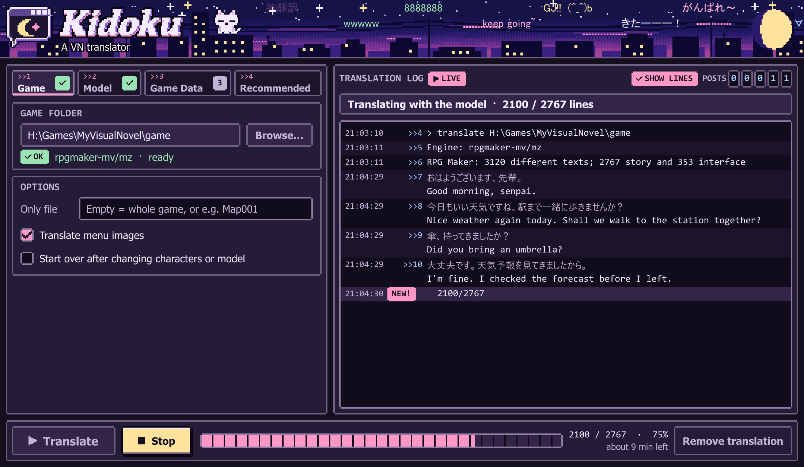
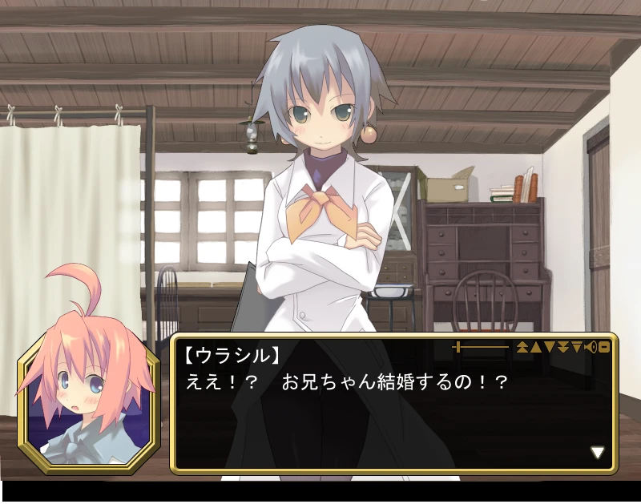
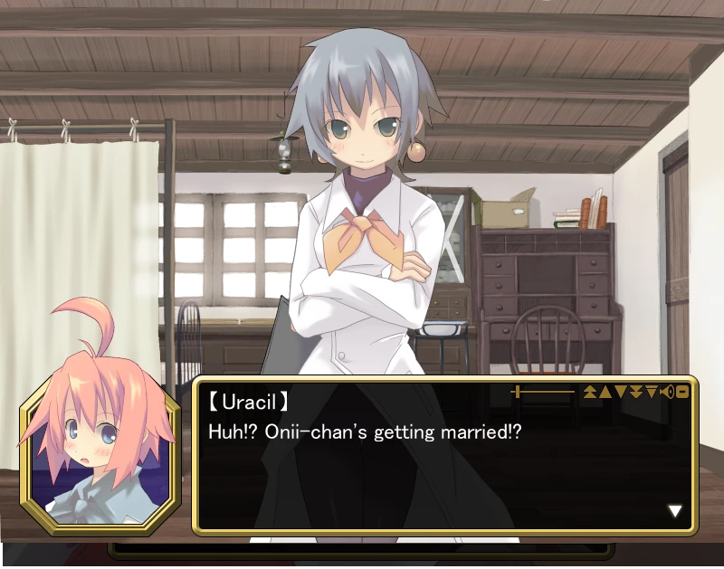
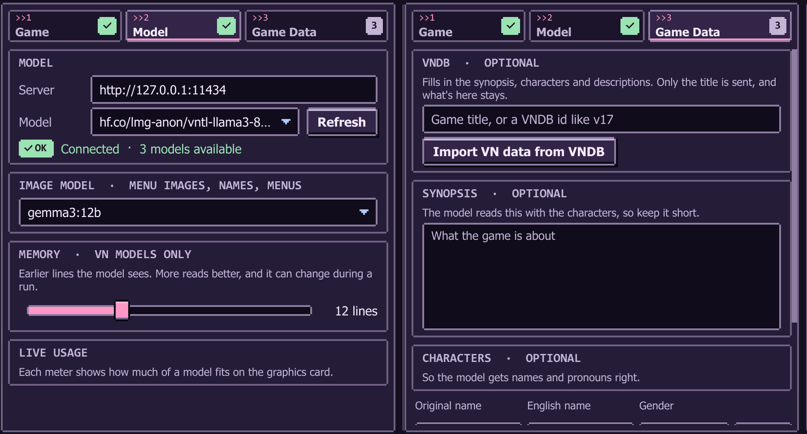
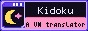

<p align="center">
  
</p>

<p align="center">
  
  
  
  
  
</p>

<h1 align="center">Kidoku</h1>

<p align="center"><b>A VN translator</b></p>

<p align="center"><b>Point it at a Japanese visual novel, press Translate, play it in English.</b></p>

> [!NOTE]
> This is a project I started for my own personal use, so it may or may not work perfectly. I made it with the help of Claude.

> **`! STICKY`** &nbsp; **Anonymous Cat** &nbsp; (=^ω^=)
>
> **How this thread works**
>
> `>>1` Pick the game folder and check its engine is OK.<br>
> `>>2` Pick a model from your model server.<br>
> `>>3` List the characters, if you want their names right.
>
> Then press **Translate**. Each finished line lands in the log as a post, and the moon fills with progress.

<p align="center">
  
</p>

## `>>1` What it does

- **Finds the engine by itself.** Pick a folder and the app tells you what the game runs on.
- **Stays on your PC.** Text only goes to your own Ollama server. A VNDB import sends just the game's title.
- **Starts from what's known.** Import a synopsis, characters and descriptions from [VNDB](https://vndb.org), all editable on the Game Data tab.
- **Picks up where it stopped.** Press **Stop** whenever you like, then **Translate** to carry on.
- **Keeps your game safe.** Every file it changes is backed up first, and **Remove translation** puts the originals back.
- **Gets names right.** Give it a list of characters and genders, and the model gets their names and pronouns.
- **Works out genders.** With an image model picked, it fills in any gender you left blank.
- **Fits text to the box.** Show it a screenshot of a long line and it measures the game's message box, then rewraps everything to match.
- **Repaints menu images.** It reads the text in buttons and menus, and paints the English in. Labels that already show English stay as they are.
- **Uses what already exists.** On Ren'Py, lines from an official translation are copied instead of translated again.
- **Shows its work.** Watch the Japanese and English arrive, or switch **SHOW LINES** off.
- **Shows what it's using.** The Model tab shows VRAM, RAM and CPU use, live.
- **Downloads models.** **Model Download** lists text and image models for 4 GB to 24 GB of graphics memory, and **All in one** gets the set tested together.

<p align="center">
  
  
</p>
<p align="center"><sub>Born Freaks! By Liar-Soft</sub></p>

## `>>2` Supported engines

| Engine | What gets translated | Menu images | Worth knowing |
|---|---|---|---|
| **Ren'Py** | Dialogue, choices and interface text | Buttons and labels on plain backgrounds, and text over artwork if you turn it on | The game starts briefly so its script can be read |
| **Unity** | String tables, or Yarn Spinner lines, on-screen text, the game's own lists and text in its code | Yarn Spinner games: text over artwork if you turn it on | Games that use Unity's Localization package or Yarn Spinner only |
| **Liar-soft** | Script and menus | Yes | Speakers come from the name plates, read by the text reader or an image model, and the plates are repainted in English. The engine patch needs a build with the same byte pattern |
| **RPG Maker MV/MZ** | Messages, choices, database, menu terms and plugin text | Short images, encrypted ones too | Other plugin settings stay Japanese until they're listed |
| **Malie** | Messages and names | Not yet | The key is found in the game's program |
| **SiglusEngine** | Messages, names, choices, the right-click menu and dialogs | Not yet | The key is worked out from the game's own scenes |
| **QLIE** | Story text, names and choices | Not yet | FilePackVer3.1 packs only |
| **Wolf RPG Editor** | Messages, choices, picture text and databases | Not yet | Old archives only |
| **RealLive** | Messages, names and choices | Not yet | Compiler 10002 scripts only |
| **CatSystem2** | Messages, names and choices | Not yet | The passphrase is read from the game's program |
| **Majiro** | Messages, names and choices | Not yet | ArcV3 archives only |
| **YU-RIS** | Messages, names and choices | Not yet | The engine wraps lines itself, and may cut words |
| **BGI/Ethornell** | Messages, names, menus and dialogs | Labels and buttons on menu screens | BURIKO ARC20 only |
| **AdvHD** | Messages, names, choices, phone messages and the settings screen's sample lines | Not yet | Shift-JIS scripts only |
| **KiriKiri** | Messages, shown tag values, and menus and dialogs in `.tjs` files | Not yet | `.ks` scripts in plain archives only |
| **Artemis** | Messages, names, choices and pop-ups | Labels on plain backgrounds, and drawn names | Version 6 and 8 archives with `.iet` scripts only |
| **Softpal** | Messages, names and choices | Not yet | `Sv20` scripts only |
| **FVP** | Messages, names and other text the script passes around | Not yet | Strings it only compares stay Japanese |
| **RPG Maker XP/VX/Ace** | Messages, choices, database, menu terms and text the scripts plainly show | Not yet | Script text is only changed where it's plainly shown on screen |
| **RPG Maker 2000/2003** | Messages, choices, database and menu terms | Not yet | Long messages go on to a new page |
| **TyranoScript** | Scenes, names, buttons and the engine's own prompts, in a folder, `app.asar` or the exe | Not yet | Other text in the game's `.js` and HTML stays Japanese |
| **NScripter** | Messages, choices and menus | Not yet | Old saves won't line up with the new script |

From Malie down, engines are checked on real games' files, and most haven't been played through yet. The [guidebook](https://github.com/vVKamiVv/Kidoku/wiki/What-each-engine-can-do) has more on each.

## `>>3` Getting started

**You'll need**

- Windows, the only system it's built and tested on
- [Ollama](https://ollama.com) for the models
- A GPU with about 6 GB of memory free, and about 6 GB of disk for the VN model

**Install it**

Get **Kidoku-Setup.exe** from the [latest release](https://github.com/vVKamiVv/Kidoku/releases/latest) and run it. It installs for your Windows user and needs no administrator rights. Windows may warn about an unknown publisher, because the app isn't signed: choose **More info**, then **Run anyway**.

To build it yourself instead, get [Rust](https://rustup.rs), the current stable version:

```bash
git clone https://github.com/vVKamiVv/Kidoku.git
cd Kidoku/app
cargo build --release
```

Then open **Kidoku.bat**. `release.bat` in the same folder builds the release files.

**Update it**

When a new version is out, Kidoku offers it at the top of its window. **What's new** shows what changed, and **Update** installs it.

**Run it**

1. Start Ollama, then open **Kidoku**.
2. Under **Model Download**, press **Get** on **All in one**: the set tested together, 20.3 GB for a 12 GB GPU. Or get the biggest text model your GPU holds. **VNTL Llama 8B** suits 8 GB.
3. On the **Game** tab, pick the game's folder.
4. Press **Translate**, and start the game when it says Done.

For menu images, genders and fitting text, also get the **Text reader** and an image model there.

On a GPU with 8 GB of memory, the text and image models run one after the other.

The [guidebook](https://github.com/vVKamiVv/Kidoku/wiki) covers every option, and what to do when something goes wrong.

<p align="center">
  
</p>

## `>>4` Memory and speed

Memory is how many earlier lines the model sees. More reads better and runs a little slower. The slider goes from 6 to 24, and works during a run.

| Memory | Lines per minute |
|---|---|
| 6 lines | About 98 |
| **12 lines (default)** | **About 91** |
| 24 lines | About 82 |

<sub>Measured with the VN model on an RTX 3060 Ti 8 GB with other programs using the card. A free card went about twice as fast. Your speed will depend on your GPU and the game's text.</sub>

## `>>5` Command line

Everything the window does also works from a terminal, with `vntl.exe`.

```bash
vntl detect <game>
vntl translate <game> --model <name>
vntl write <game>
```

<details>
<summary><b>The commands and main options</b></summary>

| Command | What it does |
|---|---|
| `detect <game>` | Shows which engine a game uses |
| `extract <game>` | Reads the game's script, or lists its Unity string tables |
| `translate <game>` | Translates, resumes where it left off, and installs the result |
| `write <game>` | Writes and checks the saved translation, without the model |
| `fit <game> <image>` | Measures the message box from a screenshot of a long line |
| `pull [model]` | Downloads a model into Ollama, the VN model by default. `pull meikiocr` gets the text reader, `pull lama` the inpainting model |
| `vndb <game> [title or id]` | Fills in the synopsis, characters and descriptions from VNDB |

| `translate` option | What it does |
|---|---|
| `--model <name>` | The model to translate with |
| `--url <address>` | The model server, Ollama by default |
| `--history <6-24>` | Earlier lines a VN model sees |
| `--vision-model <name>` | An image model, to read and repaint menu images |
| `--reading-model <name>` | A model that reads menu images better, such as `qwen2.5vl:7b`. The image model still writes their English |
| `--no-images` | Leaves menu images alone |
| `--art` | Ren'Py: also paints English over text in artwork. Slow, and it can look edited |
| `--reference <folder>` | A Ren'Py build with an official translation to copy from |
| `--label <name>` | Only this Ren'Py scene |
| `--file <name>` | Only this script or data file |
| `--ui` | With `--label` or `--file`, also translates the interface |
| `--fresh` | Starts over, setting the saved translations aside |
| `--retranslate` | Unity: retranslates text the game already has |
| `--redump` | Ren'Py: reads the script again after a game update |
| `--lang <name>` | The language slot in the game, `english` by default |

</details>

## `>>6` Your files

| Where | What's there |
|---|---|
| `vntl_work/` in the game folder | Saved progress and `characters.txt` |
| `vntl_work/box.txt` | The measured message box, in letters and rows, if you used **Fit text to the box** |
| `*.vntl-orig` next to a changed file | The original, untouched |

**Remove translation** puts the originals back and keeps your progress. If a game update changed a file, the new file stays.

This repo holds no game files. Please use the app on games you own.

## `>>7` License

Kidoku is free software under the [GNU General Public License, version 3](LICENSE). The window is made with [Slint](https://slint.dev), used under the same license.

---

<p align="center">
  
</p>

<p align="center">
  
  <br>
  <sub><i>best viewed at night with a warm GPU (^_^)</i></sub>
</p>
